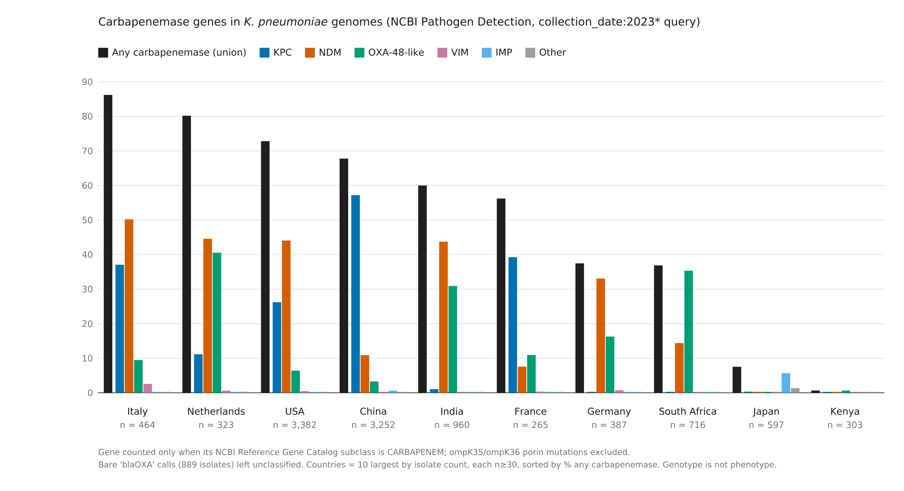

# AMR Scout: Carbapenemase Genes in *Klebsiella pneumoniae* (Claude Science Pilot)

An open-source pilot showing how a scientist can use **Claude Science**, Anthropic's AI research workbench, to explore antimicrobial resistance (AMR) in public pathogen genome data, and an honest log of where the tool shines and where it breaks.

> **Status:** Pilot, 14,466 genomes. See the [Roadmap](#roadmap) for the planned benchmark and workshop kit.

## Why this project
Before moving into AI engineering, I did microbiology research at the Haffkine Institute, Mumbai, and HIV/AIDS research at JJ Hospital, Mumbai. AMR is one of the WHO's top global health threats, and carbapenem-resistant *K. pneumoniae* is on the WHO **critical priority** pathogen list. This project asks a practical question: **what can a bench scientist realistically do with Claude Science in a single sitting?**

## Question
How common are carbapenemase gene families (KPC, NDM, OXA-48-like, VIM, IMP and others) among public *K. pneumoniae* genomes, and how does the dominant family differ by country?

## Data
- **Source:** NCBI Pathogen Detection Isolates Browser, search `taxgroup_name:"Klebsiella pneumoniae" AND collection_date:2023*`
- **Downloaded:** 2026-11-18. 14,815 isolates; **14,466 kept** after removing missing or placeholder locations (empty, `missing: …`, `not collected`)
- **Gene calls:** NCBI's AMRFinderPlus genotypes (`AMR genotypes` column). Gene detection was not re-run.
- **Note:** the collection-date column was not included in the export, so no analysis over time was done.

## Method
1. Load the export and derive `country` from `Location`; drop placeholder locations
2. Split genotype strings and strip `=COMPLETE`, `=PARTIAL` and `=POINT` suffixes
3. **Functional definition:** a gene counts as a carbapenemase only if its subclass in NCBI's **Reference Gene Catalog** includes `CARBAPENEM` (compound labels like `CARBAPENEM/TANIBORBACTAM` are split on `/`)
4. Group genes into families: KPC, NDM, OXA-48-like (incl. OXA-484), VIM, IMP, Other (GES-5, GES-24, OXA-72, AFM, L1, NWM-1)
5. Exclude porin mutations (`ompK35`/`ompK36`). They are linked to carbapenem resistance but are not carbapenemases.
6. Compare countries with at least 30 isolates; plot the top 10 by isolate count

Notebook: [`amr_scout_pilot.ipynb`](amr_scout_pilot.ipynb)

## Results

**Overall (N = 14,466)**

| Family | Isolates | % |
|---|---:|---:|
| NDM | 3,945 | 27.27 |
| KPC | 3,462 | 23.93 |
| OXA-48-like | 2,232 | 15.43 |
| VIM | 63 | 0.44 |
| IMP | 59 | 0.41 |
| Other | 14 | 0.10 |
| **Any carbapenemase** | **8,534** | **58.99** |

1,233 isolates (8.52%) carry **two or more** carbapenemase families.

**Key findings**
1. **NDM is the most common family** (27.27%), ahead of KPC (23.93%). Overall, 58.99% of genomes carry at least one carbapenemase.
2. **The dominant family depends on the country.** China is KPC-led (57.20% of 3,252), India is NDM/OXA-48-led (43.75% / 30.94% of 960) with almost no KPC (1.04%), and South Africa is OXA-48-led (35.34% of 716) with no KPC.
3. **The gap between countries reflects how isolates were sampled, not true burden.** Italy is at 86.21% (n=464), while Kenya is at 0.66% (n=303). Japan's small signal (7.54%) is mostly IMP (5.70%), a family that is rare elsewhere.

<!-- LITERATURE: add PMIDs/DOIs from the Claude Science literature step here -->

## Limitations
- **Convenience sample:** these are genomes that labs chose to sequence and deposit, a set skewed toward outbreak and resistance investigations. **These are not prevalence estimates.**
- **Genotype is not phenotype:** detecting a gene says nothing about how strongly it is expressed or about the measured MIC
- **Functional rule trade-off:** 142 isolates carrying KPC variants that NCBI does not label CARBAPENEM (e.g. KPC-33, KPC-31, which are linked to ceftazidime-avibactam resistance) are counted as KPC-negative
- **Unresolved calls:** 889 isolates (6.15%) carry a bare `blaOXA` call with no resolved allele; most likely OXA-1-type, but left unclassified
- **Sampling imbalance:** the USA and China together make up about 46% of the dataset

## Where Claude Science shone and where it broke
Each step is logged in [`benchmark_log.csv`](benchmark_log.csv). Highlights:

**Shone**
- Flagged 5 data-quality problems without being asked, including a mistake in my own prompt (the "collected in 2023" claim couldn't be verified from the exported columns)
- Checked ambiguous OXA genes against **NCBI's Reference Gene Catalog** instead of relying on recall, which found 4 carbapenemases the prompt's gene list had missed
- Asked for a human decision on scientifically ambiguous calls instead of guessing
- Spotted a parsing bug in its own rule: exact string matching would have dropped `CARBAPENEM/TANIBORBACTAM` alleles

**Broke, and recovered**
- On this Windows host, an **Application Control policy blocked every compiled plotting library** (matplotlib, Pillow, scipy). Claude Science mapped what still loaded and wrote a pure-Python, numpy-based PNG renderer ([`prender.py`](prender.py)) to produce a true 300-dpi figure. Impressive, but a scientist without coding experience couldn't have debugged this. **Product ask:** check that compiled extensions load at install time and warn the user.

## Roadmap
- [ ] Report both "KPC family present" and "functional KPC" columns
- [ ] Resolve the 889 bare `blaOXA` calls against the assemblies
- [ ] Add collection dates and analyze trends over time; cover more WHO priority pathogens
- [ ] **HIV drug-resistance kit** using the Stanford HIV Drug Resistance Database
- [ ] **Benchmark:** reproduce 15–20 published infectious-disease analyses in Claude Science, score them, and publish product recommendations
- [ ] **Lab Starter Kit:** workshop slides, notebooks, facilitator guide and an adoption survey
- [ ] Run a workshop with grad students

## Files
| File | What it is |
|---|---|
| `amr_scout_pilot.ipynb` | Full analysis notebook |
| `carbapenemase_by_country.png` | Figure (300 dpi, Okabe-Ito colorblind-safe palette) |
| `carbapenemase_presence_absence.tsv` | One row per isolate, family flags |
| `carbapenemase_prevalence.csv` | Overall prevalence with v1 → v2 changes |
| `carbapenemase_by_country.csv` | Per-country percentages plotted |
| `prender.py` | Pure-Python figure renderer (no compiled dependencies) |
| `benchmark_log.csv` | Session-by-session log of what worked and what broke |

## License
MIT
